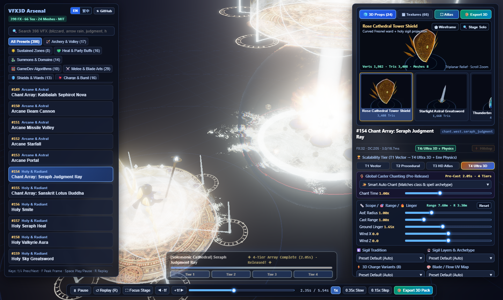
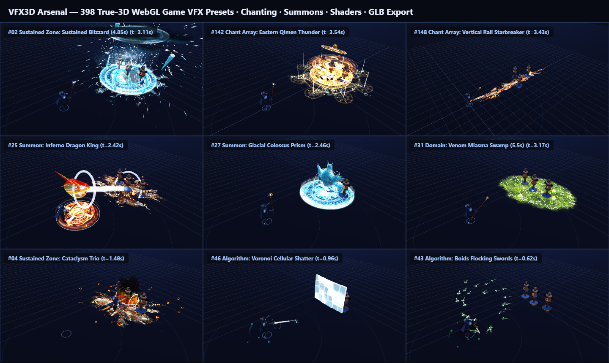

# VFX3D Arsenal — Open-Source True-3D WebGL Game VFX Library & Engine Exporter

[](https://bgbg108555.github.io/vfx3d-arsenal/)
[](https://github.com/bgbg108555/vfx3d-arsenal/actions/workflows/ci.yml)
[](./LICENSE)
[](https://threejs.org/)
[](#key-features)
[](#cli-export--blender-3d-prop-pipeline)

**English** | [繁體中文](./README.zh-TW.md) · [**🚀 Launch Live Interactive WebGL Demo →**](https://bgbg108555.github.io/vfx3d-arsenal/) · [**📦 Download Offline Single-File HTML →**](https://github.com/bgbg108555/vfx3d-arsenal/releases/latest)

**VFX3D Arsenal** is an open-source (**MIT License**) real-time **True-3D WebGL / Three.js combat & spell VFX library, interactive parameter workbench, procedural BMesh 3D prop generator, and cross-engine `.glb` / `.obj` / `.webp` / `.zip` export pipeline**.

It ships with **398 ready-to-play 3D VFX presets** across 18 gameplay categories, **global caster chanting & martial stance synchronization**, **party healing/shielding/resurrection support choreography**, **66 high-resolution `.webp` VFX textures & `4×4` SubUV flipbooks**, **24 procedural BMesh + Blender Python 3D models**, a **bilingual (`EN` default / `繁中`) live inspector**, and one-click export packages for **Blender, Unreal Engine 5 (Niagara), Unity (VFX Graph), Maya, Houdini, and Godot**.





---

## Key Features

- **398 Production-Ready True-3D VFX Presets (18 Categories)**
  - **Combat & Weaponry**: Archery & Arrow Rain (`bow`), Melee & Blade Arts (`melee`), Translucent Shields & Wards (`defense`), Multi-Stage Charge & Burst (`charge`), Buffs / Debuffs / Warcries (`buff_debuff`), Leaps / Vanguard Rushes / Grand Spells (`leap_spell`).
  - **Healing & Party Support (`heal_support`)**: Self-vitality, diamond overshields, phoenix rebirth, single-ally chalice heals, fallen-ally resurrection, curse cleansing, dual-hero soul tethers, and full-party sanctuary domes.
  - **AAA Environments, Summons & Persistent Zones (`aaa_env`, `summon_zone`)**: Sustained meteor storms, blizzards, non-circular Voronoi ground fissures, dragon/seraph/golem/reaper summons, poison swamps, quicksand vortices, and chronos stasis fields.
  - **10 Game-Dev Algorithm Showcases (`gamedev_algo`)**: Boids 3-rule flocking swords, Binary-Heap Octile A* magma fissures, Swept-Raycast CCD ricochet railgun, GPU Instancing 3-tier LOD boulder storm, Verlet + Jakobsen constraint chains, Cubic Bezier arc-length LUT homing barrage, 3D Voronoi half-plane crystal shatter, BFS shortest-hop chain lightning, and 3D divergence-free Curl-Noise phoenix flow.
  - **Elemental Schools & System FX**: Fire (`fire`), Ice & Hydro (`ice`), Lightning (`volt`), Arcane & Astral (`arcane`), Holy & Radiant (`holy`), Shadow & Abyss (`shadow`), Earth & Geo (`earth`), plus Loot / Portals / UI (`ui_fx`).

- **Strict Martial Weaponry vs. Arcane Spellcasting Separation**
  - All **170 physical weapon & martial presets** (`sword_shield`, `greatsword`, `dual_daggers`, `spear`, `scythe`, `bow`, barehand strikes) strictly spawn **zero ground magic circles**, driving impact exclusively through 3D weapon blade trails (`RibbonTrail3D`), closed 3D crescent slash arcs (`SlashArc3D`), footwork stance gusts, Mach vapor rings/cones, ground blade scars, and GPU sparks.
  - Casted spells, summons, and rituals feature **9 Global Caster Chanting Modes** with strict pre-release causality locking—guaranteeing zero premature hits or distant projectiles until the cast bar reaches `100%`, followed by `C⁰`-continuous pose transition into release.

- **Custom GLSL Shaders, GPU Sparks & Physical Particle Simulation**
  - Shared **1,024-slot analytical GPU vertex spark pool** (`GpuSparkPool3D`) for explosions, impacts, lightning, ice shatters, and starbursts.
  - **CPU micro-particle pool** (`NiagaraMicroPool3D`) with thermal blackbody cooling, buoyancy, bounded first-bounce ground child sparks, swept sphere SDF collision, and global `X/Z` wind fields.
  - Seamless `256×256` procedural erosion data textures, translucent noise-eroded Mach vapor cones/rings, optional **scene-depth Soft Particles**, and **4 live quality tiers** (`T1 Vector` -> `T2 Procedural` -> `T3 HD Atlas` -> `T4 Ultra 3D + Physics`).

- **66 High-Resolution `.webp` Textures & 24 Procedural 3D Props**
  - **66 VFX Textures**: 27 orthographic magic sigils (Eastern Bagua, Qimen, Talisman, Sword-Lotus, Mandala & Western Solomon, Hermetic, Kabbalah, Cathedral), 8 environmental destruction decals, 17 `4×4` (16-frame) animated SubUV flipbooks, and 14 seamless UV slash/aura/caustics/flow/PBR maps.
  - **24 BMesh 3D Props**: Fullered greatswords, beveled warhammers, fluted Solomonic gates, Qimen astrolabes, living world-tree staffs, and seraphic relics—available both in Three.js (`src/mesh_props3d.js`) and as a standalone **Blender 3.6–4.x Python BMesh generator** (`blender/build_vfx_models_blender.py`).

- **Universal 3D Engine Export Pipeline (`.glb` + `.obj` + `.webp` + `.zip`)**
  - Export directly from the browser UI (`📦 Export 3D`) or via the headless Node CLI (`npm run export-vfx`).
  - Bakes the complete **Chant -> Release -> Impact** simulation into a compliant **Khronos glTF 2.0 Binary (`.glb`)** with TRS node keyframe animations, `KHR_materials_emissive_strength`, `EXT_texture_webp`, static `.obj`/`.mtl` meshes, Unreal Engine 5 Niagara & Unity VFX Graph JSON bridge manifests, and one-click Blender / Maya / Unity Editor import scripts.

---

## Quick Start

### Option 1: Instant Live WebGL Demo (Zero Install)
Open **[https://bgbg108555.github.io/vfx3d-arsenal/](https://bgbg108555.github.io/vfx3d-arsenal/)** in any modern WebGL2 browser (Chrome, Edge, Firefox, Safari).
- Defaults to **English (`EN`)** with an instant **`EN | 繁中`** toggle in the top-left header.
- Also available as a 100% offline self-contained single-file HTML bundle (`VFX3D-Arsenal-Showcase.html`) on the [**Releases page**](https://github.com/bgbg108555/vfx3d-arsenal/releases/latest) or via `npm run build`.

### Option 2: Local Development & Verification Suite
Requires **Node.js >= 18** (tested on Node 22 LTS).

```bash
git clone https://github.com/bgbg108555/vfx3d-arsenal.git
cd vfx3d-arsenal
npm install

# Run full verification suite (all 398 timelines, zero-sigil martial checks, chant causality, shader bindings & GLB export)
npm test

# Build fast multi-asset web bundle into ./dist (used by GitHub Pages & npm run serve)
npm run build:web

# Build self-contained offline single-file HTML (VFX3D-Arsenal-Showcase.html)
npm run build

# Start zero-dependency local HTTP preview server at http://127.0.0.1:8080/
npm run serve
```

### Interactive Shortcuts & URL Parameters
| Key / URL Parameter | Action |
| :--- | :--- |
| `↑` / `↓` | Switch previous / next VFX preset |
| `Space` | Play / Pause timeline |
| `R` | Replay current preset from `t = 0` |
| `F` | Freeze at the preset's peak climax frame |
| Left Mouse Drag / Wheel | Orbit camera / Zoom stage |
| `?select=<preset_id>` | Deep-link directly to any preset (e.g., `?select=sum_inferno_dragon_king`) |
| `?showcase=new` | Render 3×3 multi-viewport showcase grid |
| `?lang=en` / `?lang=zh` | Force UI language (`en` default) |

---

## CLI Export & Blender 3D Prop Pipeline

```bash
# Export a single animated 3D VFX skill package (.zip + .glb)
npm run export-vfx -- --id chant_seraph_judgment_ray --fps 30 --out ./exports

# Export VFX-only animation without character/dummy meshes
npm run export-vfx -- --id env_sustained_meteor_rain --no-actors --fps 30 --out ./exports

# Batch-export all 24 procedural BMesh 3D geometry props (.zip + .glb + .obj)
npm run export-vfx -- --all-props --out ./exports/props

# Generate subdivided & beveled .glb / .fbx / .blend master library natively in Blender 3.6 LTS – 4.x
blender --background --python blender/build_vfx_models_blender.py -- --out ./exports/models --formats glb,fbx,blend
```

---

## Repository Structure

See [`docs/ARCHITECTURE.md`](./docs/ARCHITECTURE.md) for an in-depth technical breakdown of the simulation runtime, shaders, and glTF 2.0 animation baker.

```text
vfx3d-arsenal/
├── .github/workflows/              # Automated CI (398-preset verification) & GitHub Pages deployment
├── assets/                         # 66 high-res .webp textures (27 sigils, 8 ground decals, 17 4x4 flipbooks, 14 UV maps)
├── blender/                        # Native Blender 3.6–4.x Python BMesh generator for all 24 3D VFX props
├── docs/                           # Architecture guide & rendered showcase previews
├── scripts/
│   ├── pack-textures.mjs           # Packs assets/*.webp into src/baked_textures.js for offline builds & Node tests
│   ├── export-vfx-pipeline.mjs     # Headless universal .glb / .obj / .zip VFX export CLI
│   └── serve.mjs                   # Hardened local HTTP preview server (127.0.0.1:8080)
├── src/
│   ├── app.js                      # WebGL stage, live parameter controls, 3D mesh turntable & export modal
│   ├── i18n.js                     # Bilingual localization dictionary & preset translator (EN default / 繁中)
│   ├── core3d.js                   # Sim3D runtime, Flipbook / RibbonTrail / SlashArc / refractive shield shaders
│   ├── niagara3d.js                # CPU micro-particle pool, thermal cooling, child sparks & SDF collision
│   ├── gpu_sparks3d.js             # Analytical GPU vertex spark pool (1,024 slots)
│   ├── vapor3d.js                  # Noise-eroded translucent Mach shock rings & vapor cones
│   ├── chant_system3d.js           # Global caster chanting, martial stance windup & timeline causality lock
│   ├── magic_arrays3d.js           # Multi-layer Eastern/Western magic arrays & cast bar HUD
│   ├── env_fx3d.js                 # Non-circular Voronoi ground fissures, charge variants & sustained storms
│   ├── gamedev_algos3d.js          # 10 game-development math & simulation algorithms
│   ├── mesh_props3d.js             # 24 procedural 3D weapons, shields, staffs & arcane constructs
│   ├── vfx_exporter3d.js           # Khronos glTF 2.0 (.glb) TRS animation baker & engine bridge packager
│   ├── moves3d.js                  # Master registry of 18 categories & 398 3D VFX presets
│   └── presets_*.js                # Modular 3D VFX preset packs (open for community expansion!)
├── tests/
│   ├── check-fx3d.mjs              # 398-preset timeline, zero-sigil martial, chant sync & GLB export test suite
│   ├── check-bow3d.mjs             # Arrow flight orientation, Mach vapor translucency & arrow-rain timing tests
│   └── check-fx-visuals.mjs        # Ribbon taper, GPU spark pool, soft-depth fade & GLB buffer tests
└── build.mjs                       # Dual bundler (--web dist for GitHub Pages / standalone single-file HTML)
```

---

## Contributing & Governance

Contributions from VFX artists, shader programmers, and game developers are welcome!
- Read [`CONTRIBUTING.md`](./CONTRIBUTING.md) for preset guidelines and verification commands.
- Read [`CODE_OF_CONDUCT.md`](./CODE_OF_CONDUCT.md) and [`SECURITY.md`](./SECURITY.md) for community and security policies.

---

## License

Released under the [**MIT License**](./LICENSE). Free for personal, academic, and commercial game development.
