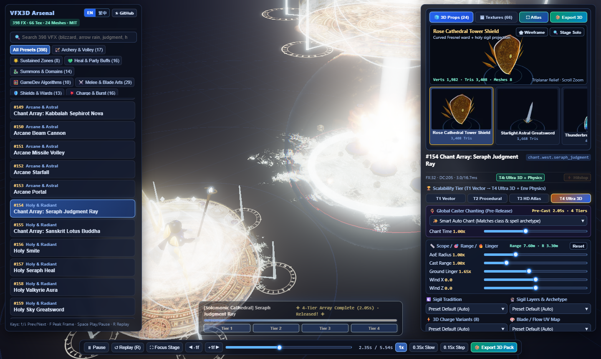
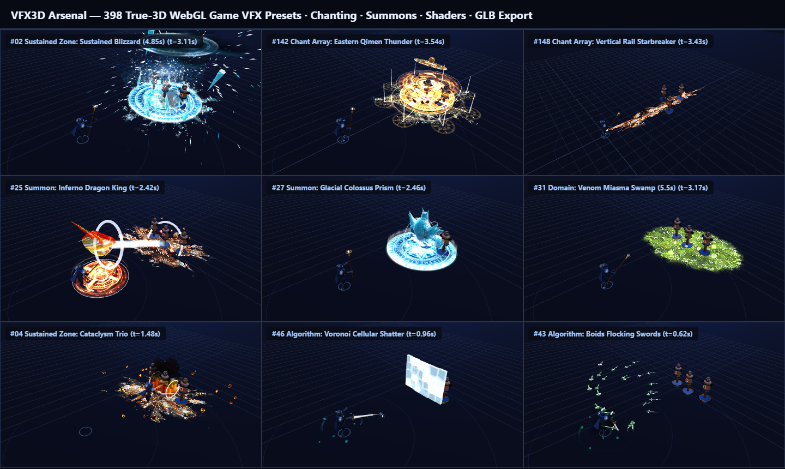

# VFX3D Arsenal — 開源真 3D 遊戲特效全武庫與跨引擎匯出流水線

[](https://bgbg108555.github.io/vfx3d-arsenal/)
[](https://github.com/bgbg108555/vfx3d-arsenal/actions/workflows/ci.yml)
[](./LICENSE)
[](https://threejs.org/)
[](#核心特色)
[](#跨引擎-cli-匯出與-blender-建模產線)

[English](./README.md) | **繁體中文** · [**🚀 立即開啟線上 WebGL 互動預覽 →**](https://bgbg108555.github.io/vfx3d-arsenal/) · [**📦 下載離線單檔 HTML 展示包 →**](https://github.com/bgbg108555/vfx3d-arsenal/releases/latest)

**VFX3D Arsenal** 是一套以 **MIT License** 開源的 **真 3D WebGL / Three.js 遊戲戰鬥與技能特效展示、即時調參與跨軟體輸出全武庫**。內建 **398 組真 3D 特效預設**（橫跨 18 大遊戲特效分類）、**全技能通用施法者詠唱／蓄勢因果鎖定系統**、**物理武器與武技零魔法陣純粹氣勁／刀軌表現**、**治癒／護盾／復活／淨化隊友輔助系統**、**66 張高解析度 `.webp` 特效貼圖與 4×4 SubUV 序列圖**、**24 款程序化 BMesh + Blender Python 3D 幾何模型**、**預設英文 (`EN`) 並支援一鍵切換 `繁中` 的雙語工作台介面**，以及 **一鍵匯出 `.glb` + `.obj` + `.webp` + `.zip` 至 Blender / Unreal Engine 5 (Niagara) / Unity (VFX Graph) / Maya / Houdini / Godot 的通用流水線**。





---

## 核心特色

- **398 組開箱即用真 3D 特效預設（18 大分類）**：
  - 🏹 弓箭射擊／箭雨、⚔️ 刀劍武技、🛡️ 半透明盾防、💥 蓄力爆發技、🧪 增益／減益／戰吼、☄️ 衝鋒／飛天／大法術
  - 💚 治癒／護盾／隊友輔助（含單體聖療、倒地復活、破咒驅散、全隊護盾與雙人靈魂連結）
  - 🌟 3A 環境破壞與持續區域法術、🐉 召喚魔法與領域結界、🧮 10 大遊戲演算法實戰（Boids 群聚飛劍、Octile A* 地裂、Swept-Raycast 防穿隧跳彈、Verlet 鐵鏈、Voronoi 3D 碎裂、3D Curl-Noise 流體等）
  - 🔥 烈焰、❄️ 寒冰水系、⚡ 雷電、🔮 奧術、✨ 神聖、💀 暗影、🪨 大地、💎 系統／拾取／空間轉場
- **物理武技 vs 法術詠唱嚴格分流**：
  - 所有 170 招刀劍、長槍、戰斧、巨錘、弓箭與體術武技嚴格零地面魔法陣，採用 **武器刀刃流光軌跡 (`RibbonTrail3D`)、封閉 3D 彎月刀弧 (`SlashArc3D`)、踏步鬥氣爆風、音爆氣浪與裂地刀痕**。
  - 法術與召喚支援 **9 種全域詠唱／蓄勢模式**，保證施法讀條完成前零提前命中、零越界投射物，讀條 100% 瞬間無縫銜接釋放動作。
- **GPU／Shader 粒子與環境物理**：
  - 共用 1,024 槽解析軌跡 GPU 頂點火花池 (`GpuSparkPool3D`)、溫度冷卻與浮力煙火、首次觸地次級火花、X/Z 全域風場、可選場景深度粒子交界柔化 (`Soft Particles`)、無縫雙通道侵蝕遮罩 (`erosionNoise`)。
- **跨 3D 軟體通用匯出流水線 (`.glb` / `.obj` / `.webp` / `.zip`)**：
  - 網頁右上角點擊 **`📦 Export 3D`（或切換 `繁中` 後點擊 `📦 匯出3D包`）** 或使用 Headless CLI，即可將任一招式的完整「蓄勢／詠唱 ➔ 釋放 ➔ 命中」烘焙為標準 **Khronos glTF 2.0 Binary (`.glb`)** TRS 關鍵幀動畫包，內附 UE5 Niagara / Unity VFX Graph 描述檔與 Blender / Maya 匯入腳本。

---

## 快速開始

### 方式一：線上 GitHub Pages 即時預覽（免安裝）
直接開啟 **[https://bgbg108555.github.io/vfx3d-arsenal/](https://bgbg108555.github.io/vfx3d-arsenal/)** 即可於瀏覽器內即時預覽與匯出 3D 特效包（介面預設為國際英文 `EN`，左上角可隨時一鍵切換 **`EN | 繁中`**，或使用網址 `?lang=zh`）。
若需離線免伺服器單檔版本，可至 [**GitHub Releases**](https://github.com/bgbg108555/vfx3d-arsenal/releases/latest) 下載 `VFX3D-Arsenal-Showcase.html`。

### 方式二：本機開發與自動化驗證
環境需求：**Node.js >= 18**（建議 Node 22 LTS）

```bash
git clone https://github.com/bgbg108555/vfx3d-arsenal.git
cd vfx3d-arsenal
npm install

# 執行自動化測試（398 招時間軸、零法陣武技規範、詠唱因果同步、Shader 貼圖綁定與 GLB 匯出驗證）
npm test

# 建置高速網頁部署包 ./dist（供 GitHub Pages 與本機預覽伺服器使用）
npm run build:web

# 建置離線免伺服器單檔展示頁 VFX3D-Arsenal-Showcase.html
npm run build

# 啟動本機預覽伺服器 (預設 http://127.0.0.1:8080/)
npm run serve
```

---

## 跨引擎 CLI 匯出與 Blender 建模產線

```bash
# 匯出單一動畫技能特效包 (.zip + .glb)
npm run export-vfx -- --id chant_seraph_judgment_ray --fps 30 --out ./exports

# 批次匯出全套 24 款程序化 3D 幾何模型 (.zip + .glb + .obj)
npm run export-vfx -- --all-props --out ./exports/props

# 若本機安裝有 Blender 3.6 LTS ~ 4.x，可原生生成細分導角 .glb / .fbx / .blend 母檔
blender --background --python blender/build_vfx_models_blender.py -- --out ./exports/models --formats glb,fbx,blend
```

---

## 專案結構

詳細渲染架構與 glTF 2.0 烘焙規格請參閱 [`docs/ARCHITECTURE.md`](./docs/ARCHITECTURE.md)。

```text
vfx3d-arsenal/
├── .github/workflows/              # GitHub Actions 自動化測試 (CI) 與 GitHub Pages 自動部署
├── assets/                         # 66 張高解析度 .webp 貼圖（27 法陣 + 8 地表 + 17 4x4 序列圖 + 14 UV 貼圖）
├── blender/                        # 原生 Blender 3.6~4.x Python BMesh 24 款 3D 模型生成腳本
├── docs/                           # 系統架構文件與展示預覽圖
├── scripts/
│   ├── pack-textures.mjs           # 自動將 assets/*.webp 封裝為 src/baked_textures.js
│   ├── export-vfx-pipeline.mjs     # Headless 萬用 .glb / .obj / .zip 特效匯出 CLI
│   └── serve.mjs                   # 零依賴安全本機 HTTP 預覽伺服器 (127.0.0.1:8080)
├── src/
│   ├── app.js                      # WebGL 舞台、即時參數面板、3D 轉盤與匯出對話框
│   ├── i18n.js                     # 雙語介面與 398 招預設詞庫（預設 EN / 支援 繁中 即時切換）
│   ├── core3d.js                   # Sim3D 核心、Flipbook / RibbonTrail / SlashArc / 折射護盾 Shader
│   ├── niagara3d.js                # CPU 微粒子流體池、溫度冷卻、觸地次級火花與力場碰撞
│   ├── gpu_sparks3d.js             # GPU 頂點解析軌跡火花池
│   ├── vapor3d.js                  # 噪聲侵蝕半透明音爆環與馬赫氣錐
│   ├── chant_system3d.js           # 全技能通用詠唱／武技鬥氣蓄勢與時間軸因果鎖定系統
│   ├── magic_arrays3d.js           # 東方奇門／西方聖堂／立體銃口多層次法陣與讀條 HUD
│   ├── env_fx3d.js                 # 非圓形 Voronoi 複合地裂、蓄力變體與持續區域風暴
│   ├── gamedev_algos3d.js          # 10 大遊戲演算法實作模組
│   ├── mesh_props3d.js             # 24 款程序化 3D 武器／聖物／法杖／魔像幾何生成庫
│   ├── vfx_exporter3d.js           # Khronos glTF 2.0 (.glb) 動畫烘焙器與跨引擎打包核心
│   ├── moves3d.js                  # 18 大分類與 398 組特效預設總表入口
│   └── presets_*.js                # 各分類模組化 3D 特效預設集（歡迎社群持續擴充！）
├── tests/                          # 398 招時間軸、弓箭氣浪、刀軌收尖與 GLB 匯出自動化測試套件
└── build.mjs                       # 雙模式封裝器（--web dist 網頁包 / 單檔離線 HTML）
```

---

## 社群擴充與貢獻指南

非常歡迎提交 Pull Request 新增原創招式特效、Shader 材質、3D 幾何道具或各遊戲引擎匯入腳本！詳見 [`CONTRIBUTING.md`](./CONTRIBUTING.md)、[`CODE_OF_CONDUCT.md`](./CODE_OF_CONDUCT.md) 與 [`SECURITY.md`](./SECURITY.md)。

## 授權條款 (License)

本專案採用 [**MIT License**](./LICENSE) 開源授權，可自由用於個人、學術研究與商業遊戲專案開發。
